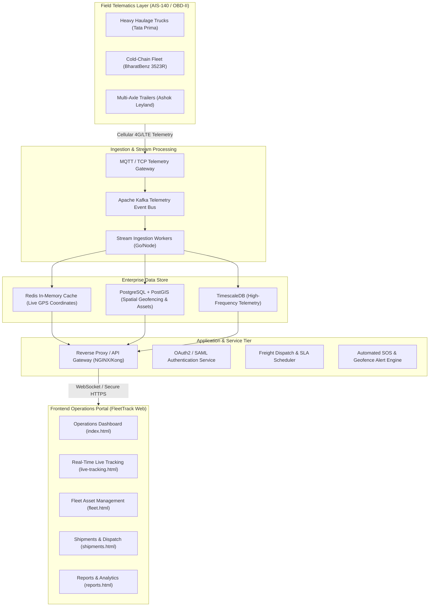

# FleetTrack Logistics OS — Enterprise System Architecture

## 1. Executive Summary

**FleetTrack Logistics OS** is an enterprise-grade, real-time telematics and supply chain orchestration platform engineered for commercial vehicle fleets, long-haul freight operations, and critical cold-chain monitoring. The portal complies with the **AIS-140 Indian Intelligent Transportation Systems standard** and integrates high-precision GPS telematics, OBD-II CAN-bus diagnostics, and automated consignment scheduling.

---

## 2. High-Level System Architecture Diagram



---

## 3. Core Architectural Principles

### 3.1 Zero-UI Regression Architecture
- **Multi-Page Application (MPA)** with Vite 6 build pipeline.
- All HTML entry points are accessible as standalone views, ensuring **100% backward compatibility** with VS Code Live Server, Vite dev server, and production static hosting (S3, Cloudflare Pages, NGINX).
- UI styles, design tokens, and components are centralized in `src/styles/` and `src/config/` without altering single layout pixels.

### 3.2 Security & Compliance (AIS-140)
- **AIS-140 Standard Compliance**: Dedicated emergency SOS button telemetry, twin-IP transmission redundancy, tamper-proof GNSS data stream.
- **Client-Side Auth Barrier**: Protected route gates verify cryptographic session tokens in `localStorage` before rendering sensitive telematics maps.
- **Transport Security**: Enforces HTTPS and WSS (WebSocket Secure) with 256-bit TLS encryption.

### 3.3 Micro-Modular Frontend Structure
```
frontend/
├── docs/                     # Architectural, telematics, and presentation docs
├── public/                   # Public static assets, mock telemetry feeds, icons
│   ├── data/                 # JSON payloads (telemetry, shipments, drivers)
│   ├── favicon.svg           # FleetTrack brand icon
│   └── manifest.json         # PWA Manifest
├── src/                      # Modular enterprise code
│   ├── config/               # Theme tokens & app configuration
│   ├── data/                 # Mock database seeds
│   ├── modules/              # Auth, telematics, and Leaflet map engine
│   ├── services/             # Storage abstractions & telemetry stream simulator
│   ├── styles/               # Main theme, scrollbars, and map animations
│   └── utils/                # Date, currency, geospatial and DOM helpers
├── index.html ... (11 pages) # Root entry points with verified zero-regression UI
├── vite.config.js            # Optimized MPA Rollup build configuration
└── package.json              # Project scripts and dependencies
```

---

## 4. Hardware Telematics Ingestion Metrics

| Parameter | Specification | Purpose |
|---|---|---|
| **GNSS Tracking** | GPS + GLONASS + NavIC | Sub-2.5m horizontal positioning accuracy |
| **OBD-II CAN-Bus** | ISO 15765-4 (CAN 2.0B) | Engine RPM, coolant temp, fuel rate, diagnostic trouble codes |
| **AIS-140 SOS** | Dual IP Transmission | Instant panic alert forwarding to transport command center |
| **Battery Backup** | 4.2V 600mAh Li-ion | Minimum 4 hours continuous ping if vehicle battery is disconnected |
| **Frequency** | 5 seconds (moving) / 60 seconds (idle) | Optimized cellular bandwidth utilization |

---

## 5. Deployment Topology

The application can be containerized using a minimal multi-stage Alpine NGINX container:

```dockerfile
# Multi-Stage Build
FROM node:20-alpine AS build
WORKDIR /app
COPY package*.json ./
RUN npm ci
COPY . .
RUN npm run build

FROM nginx:alpine
COPY --from=build /app/dist /usr/share/nginx/html
EXPOSE 80
CMD ["nginx", "-g", "daemon off;"]
```
