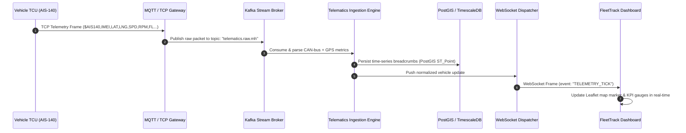
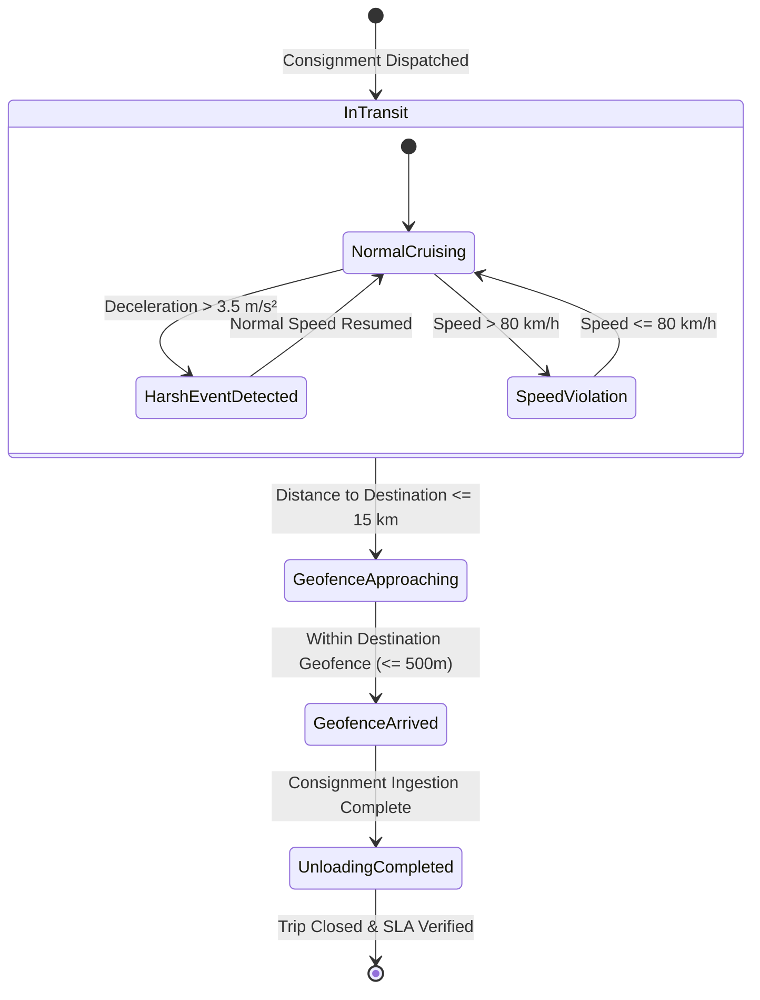

# Telematics Dataflow & Communication Protocol

## 1. Real-Time Telemetry Pipeline Overview

The FleetTrack telematics engine continuously ingests binary telemetry packets transmitted over 4G/LTE cellular modems from onboard AIS-140 GPS and OBD-II telematics control units (TCU).



---

## 2. Standard Packet Payload Specification

When an onboard telematics unit transmits a packet, the data payload conforms to the following schema:

```json
{
  "header": {
    "protocol": "AIS-140-v2",
    "imei": "864293049102845",
    "timestamp": "2026-10-25T11:00:00.000Z",
    "packetType": "PERIODIC_LOCATION_HEALTH"
  },
  "gnss": {
    "latitude": 18.7537,
    "longitude": 73.4063,
    "altitudeMeters": 580.4,
    "speedKmph": 68.4,
    "headingDegrees": 312,
    "satellites": 14,
    "hdop": 0.9,
    "fixStatus": "3D_FIX"
  },
  "canBusDiagnostics": {
    "engineRpm": 1650,
    "coolantTemperatureC": 88,
    "fuelTankLevelPercent": 76.5,
    "batteryVoltageV": 24.2,
    "odometerKm": 142850.2,
    "instantFuelEconomyKmpL": 4.1,
    "engineLoadPercent": 62.0
  },
  "safetySensors": {
    "ignitionStatus": true,
    "panicButtonPressed": false,
    "harshAcceleration": false,
    "harshBraking": false,
    "tiltAngleDegrees": 1.2,
    "boxDoorOpen": false
  }
}
```

---

## 3. Geofencing & Alert State Machine



---

## 4. Key Performance Indicators (KPIs) Computed by Engine

1. **Estimated Time of Arrival (ETA)**:
   $$\text{ETA} = \text{Current Time} + \frac{\text{Remaining Distance}}{\text{Historical Corridor Velocity}} + \text{Toll Plaza Buffer}$$
2. **Fuel Thermal Efficiency Index (FTEI)**:
   Calculated by correlating CAN-bus fuel flow rate with engine RPM and gradient load.
3. **Driver Safety Score (0 - 100)**:
   Base score of 100 penalized by harsh braking instances, speed infractions, and continuous driving exceeding 4 hours without rest.
